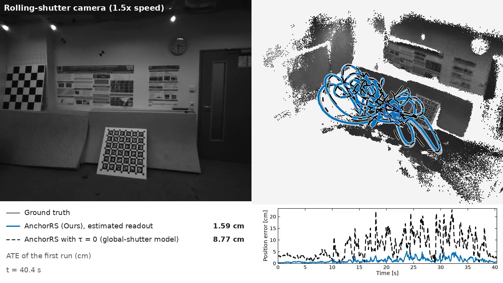

# AnchorRS: Rolling-Shutter-Aware Camera Trajectories from Feed-Forward 3D Models

[Project Page](https://arthur031221.github.io/anchorrs/) | [Paper](https://arthur031221.github.io/anchorrs/paper.pdf)

<p align="center">
  
</p>

AnchorRS takes a long monocular video with known intrinsics and returns the camera pose of every frame and the readout time of the rolling shutter.
A frozen feed-forward 3D model (pi3) reconstructs windows of the video that all share the same anchor frames, so the drift after Sim(3) synchronization stays bounded as the video grows.
A global bundle adjustment on the CPU then refines all poses with a rolling-shutter model whose readout time is estimated from the video itself, without retraining or shutter calibration.

## Installation

AnchorRS runs in two steps.
The windows step runs pi3 on the GPU.
We tested it with Python 3.11.13, PyTorch 2.8.0 and CUDA 12.6 on an NVIDIA Quadro RTX 8000.
The solver (`run.py`) runs on the CPU.
We tested it with Python 3.11.17, PyTorch 2.14.1, NumPy 2.4.6, SciPy 1.17.1 and OpenCV 5.0.0 on an Intel Core i7-12700K.

Clone this repository and install it with its dependencies.

```bash
git clone https://github.com/Arthur031221/anchorrs.git
cd anchorrs
conda create -n anchorrs python=3.11
conda activate anchorrs
pip install torch==2.8.0 torchvision==0.23.0 --index-url https://download.pytorch.org/whl/cu126
pip install -e .
```

Install pi3 from the [official repository](https://github.com/yyfz/Pi3). We used commit `9fa3ddb`.

```bash
git clone https://github.com/yyfz/Pi3.git
git -C Pi3 checkout 9fa3ddb
pip install -e Pi3 huggingface_hub pillow
```

`run.py` loads the released pi3 weights from Hugging Face (`--checkpoint yyfz233/Pi3`, the default).
You can also download [model.safetensors](https://huggingface.co/yyfz233/Pi3/resolve/main/model.safetensors) and pass its path with `--checkpoint`.

## Data

| Dataset | Official source | Sequences | Folder |
| :--- | :--- | :--- | :--- |
| TUM RGB-D | [download page](https://cvg.cit.tum.de/data/datasets/rgbd-dataset/download) | fr3/walking_static, walking_xyz, walking_halfsphere, walking_rpy | `data/tum` |
| Bonn RGB-D Dynamic | [dataset page](https://www.ipb.uni-bonn.de/data/rgbd-dynamic-dataset) | the eight sequences in `configs/bonn.yaml` | `data/bonn` |
| TUM rolling shutter | [dataset page](https://cvg.cit.tum.de/data/datasets/rolling-shutter-dataset) | dataset-seq1 to dataset-seq10, EuRoC format | `data/tum_rs` |

The three scripts below fetch the sequences from the official servers and extract them into these folders.

```bash
bash scripts/download_tum.sh
bash scripts/download_bonn.sh
bash scripts/download_tum_rs.sh
```

The rolling-shutter sequences are the largest, dataset-seq1 alone is 1.85 GB.
The code reads the folders below. Other files in the archives are not used.

```
data/
  tum/
    rgbd_dataset_freiburg3_walking_static/
      rgb/
      rgb.txt
      groundtruth.txt
    ...
  bonn/
    rgbd_bonn_balloon/
      rgb/
      rgb.txt
      groundtruth.txt
    ...
  tum_rs/
    dataset-seq1/
      mav0/cam1/data/
      mav0/cam1/data.csv
      dso/camchain.yaml
      dso/gt_imu.csv
    ...
```

For TUM RGB-D and Bonn, the video consists of the frames of `rgb.txt` with a ground-truth pose within 20 ms.
For the TUM rolling-shutter dataset, `run.py` first remaps the fisheye images of the camera to 640x512 pinhole images in `<sequence>/pinhole_cam1` and keeps all frames.

## Quick start

```bash
python run.py --config configs/tum.yaml \
    --seq data/tum/rgbd_dataset_freiburg3_walking_static \
    --windows windows/tum/rgbd_dataset_freiburg3_walking_static.npz \
    --seed 0 --out outputs/tum/rgbd_dataset_freiburg3_walking_static_s0.npz
python evaluate.py --config configs/tum.yaml \
    --seq data/tum/rgbd_dataset_freiburg3_walking_static \
    --traj outputs/tum/rgbd_dataset_freiburg3_walking_static_s0.npz
```

If the file given by `--windows` does not exist, `run.py` first computes it on the GPU.
Each window holds 64 frames, the 16 anchor frames and one block of 48 consecutive frames.
For the 740 frames of walking_static, pi3 reconstructs 16 windows in 402 s on one Quadro RTX 8000.
The solver then synchronizes the windows, matches SIFT features and runs the bundle adjustment on the CPU, in 311 s for walking_static.
It writes the camera-to-world matrices of all frames (`c2w`), the estimated readout time (`readout_ms`) and the frame names to the output file.
`evaluate.py` prints the ATE in cm, about 0.38 cm for this sequence and seed.

Add `--global-shutter` to fix the readout time to zero.
The thread counts are part of the setup. `run.py` sets OpenMP, MKL and OpenBLAS to two threads unless they are already set, and other values can change the results slightly.

## Reproducing the paper

Each script runs the windows step for all sequences of a dataset, then the solver for seeds 0, 1 and 2 with and without the rolling-shutter model, and prints the mean ATE over the sequences and seeds.
A windows file is computed once and reused by all six solver runs of its sequence.

```bash
bash scripts/eval_tum.sh      # TUM RGB-D, four sequences
bash scripts/eval_bonn.sh     # Bonn RGB-D Dynamic, eight sequences
bash scripts/eval_tum_rs.sh   # TUM rolling shutter, camera cam1, ten sequences
```

Mean ATE in cm over the sequences and three seeds.

| Dataset | Sequences | Shutter model | Paper | Release |
| :--- | :---: | :--- | :---: | :---: |
| TUM RGB-D | 4 | estimated readout | 0.93 | 0.93 |
| TUM RGB-D | 4 | τ = 0 | 1.53 | 1.53 |
| Bonn RGB-D Dynamic | 8 | estimated readout | 1.38 | 1.38 |
| Bonn RGB-D Dynamic | 8 | τ = 0 | 2.13 | 2.13 |
| TUM rolling shutter (cam1) | 10 | estimated readout | 1.23 | 1.23 |
| TUM rolling shutter (cam1) | 10 | τ = 0 | 6.70 | 6.70 |

The ATE follows the protocol of WildGS-SLAM and [evo](https://github.com/MichaelGrupp/evo).
It is the RMSE of the camera positions after a Sim(3) Umeyama alignment of the whole trajectory to the ground truth, over all frames with a ground-truth pose.
On the rolling-shutter camera of the TUM rolling-shutter dataset, a pose refers to the time of the principal row, so the ground truth is interpolated at the frame time stamp plus 15.25 ms (the reported readout time of 30.18 ms times 517.3 of 1024 rows).
A frame is evaluated only if the ground truth is valid both at its time stamp and at that later time.
Valid means inside the motion-capture record, with the two motion-capture samples around it at most 25 ms apart.

## Citation

```bibtex
@misc{lee2026anchorrs,
  title={{AnchorRS}: Rolling-Shutter-Aware Camera Trajectories from Feed-Forward {3D} Models},
  author={Chi-Wei Lee and Yi-Chun Chang and Cheng-Han Chiang and An-Kai Chen and Po-Chih Kuo},
  year={2026},
  howpublished={\url{https://arthur031221.github.io/anchorrs/}}
}
```

## Acknowledgements

The windows come from [pi3](https://github.com/yyfz/Pi3) and its [released weights](https://huggingface.co/yyfz233/Pi3).
We evaluate on [TUM RGB-D](https://cvg.cit.tum.de/data/datasets/rgbd-dataset), [Bonn RGB-D Dynamic](https://www.ipb.uni-bonn.de/data/rgbd-dynamic-dataset) and the [TUM rolling-shutter dataset](https://cvg.cit.tum.de/data/datasets/rolling-shutter-dataset).
The ATE follows [evo](https://github.com/MichaelGrupp/evo). Features and image remapping use [OpenCV](https://opencv.org/).

## License

The code is released under the MIT license (see [LICENSE](LICENSE)).
The pi3 weights are licensed separately under [CC BY-NC 4.0](https://creativecommons.org/licenses/by-nc/4.0/).
